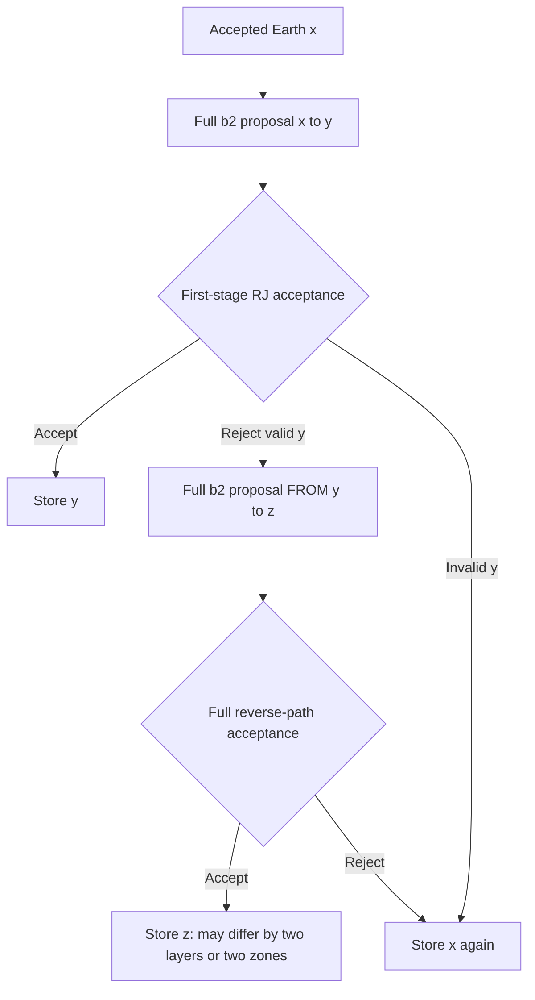

# Layered-Earth two-stage reversible-jump proposals

> Historical review. Current settings and executed tests are in [THBI_RANDOM_SECOND_MOVE.md](THBI_RANDOM_SECOND_MOVE.md) and [THBI_EXTENDED100_REVIEW.md](THBI_EXTENDED100_REVIEW.md).


Updated 2026-11-08. This supersedes the fixed-scalar-only DR description in
the earlier workflow audit. Source and standalone Code Analyzer checks only:
the agent has not executed MATLAB, numerical tests, CPS/HVf or an inversion.

## Algorithm and relationship to Zach's scripts

The `extended60` profile now selects `par.proposal.dr.mode='layered_path'`.
It follows the proposal control flow in the local Zach/Brennan
`THBI_MCMC/functions/master_subfuncs/delay_reject.m`: after a valid first
candidate is rejected, make another proposal from that rejected candidate.
Both attempts select from the full move mixture. In our code these are
layer velocities, interfaces, zone boundaries, physical layer splits/merges,
and hierarchical noise scales. No spline coordinates or knot-count factors
are used.

The local reference multiplies birth/death factors and calls its ordinary
acceptance rule. Here the second acceptance includes the probability of
rejecting the intermediate model in BOTH directions. The general framework
is [Green & Mira (2001), Delayed rejection in reversible jump
Metropolis–Hastings](https://people.maths.bris.ac.uk/~mapjg/abstracts/delayed.html),
DOI [10.1093/biomet/88.4.1035](https://doi.org/10.1093/biomet/88.4.1035).
The expressions below are our specialization to the implemented two-leg
layered proposal, not equations copied from the reference repository.



The intermediate y is not a posterior sample. One MCMC iteration stores x,
y or z exactly once. If x->y is a birth and y->z is a birth, accepting the
second stage changes K by +2; a birth/death pair may change structure while
leaving the count unchanged. Neither a second-stage birth nor a death is
mandatory: b2 draws the family anew from the same fixed probabilities.

## Layered split/merge map and first-stage density

For a layer between fractional depths a and b, split at s, draw contrast d,
and let r=(s-a)/(b-a). The daughters have

```text
v_left  = v - (1-r)*d
v_right = v + r*d
```

The inverse merge recovers v=r*v_left+(1-r)*v_right and
d=v_right-v_left. The augmented map (v,s,d)->(v_left,s,v_right) has absolute
Jacobian one. Fractions, not absolute depths, are the sampled coordinates.
With K parent layers and E splittable parents, b2 uses

```text
q_birth = p_birth * p_zone / E / (b-a-2*gap) * g(d)
q_death_reverse = p_death * p_zone / K
```

g is the full narrow/broad Gaussian mixture. The prior still contains its
count mass, velocity-volume factors and ordered-interface normalization.
The proposal and prior are separate terms. At count bounds, invalid proposals
are rejected; the family probabilities are not renormalized or redrawn.

## Second-stage derivation

Let pi be the full posterior density, including the normalized hierarchical
likelihood and model/noise priors. Record each selected move label and its
auxiliary variables. For a leg a->b define

```text
H_ab = log q(b->a) - log q(a->b) + log|J_ab|
alpha1(a,b) = min(1, exp(log pi(b)-log pi(a)+H_ab))
```

Draw both legs using the SAME b2 kernel Q: x->y, then y->z after rejecting
the first candidate. The reverse labelled path is z->y, then y->x. Reverse
the second map and then the first; the augmented dimensions match and the
combined Jacobian is |J_xy*J_yz|. Pair the path densities:

```text
Forward: pi(x) q(x->y) [1-alpha1(x,y)] q(y->z)
Reverse: pi(z) q(z->y) [1-alpha1(z,y)] q(y->x)
```

Taking their ratio, including the combined Jacobian, gives

```text
log r2 = log pi(z)-log pi(x) + H_xy + H_yz
       + log[1-alpha1(z,y)] - log[1-alpha1(x,y)]
alpha2 = min(1, exp(log r2))

log alpha1(x,y) = min(0, log pi(y)-log pi(x)+H_xy)
log alpha1(z,y) = min(0, log pi(y)-log pi(z)-H_yz)
```

The reverse first-stage ratio is the inverse of the actual SECOND leg's RJ
ratio. It is not obtained by comparing likelihoods alone. The code evaluates
log(1-alpha) with `log(-expm1(logalpha))`; if either first-stage acceptance is
certain, the corresponding delayed path has zero rejection support.

For every implemented split, merge and scalar map, |J|=1, but both Jacobian
fields remain explicit in the acceptance code. Scalar move/zone/index and
Gaussian densities are now recorded as absolute log densities when DR is
enabled; their individual reverse/forward ratios cancel. RJ selection and
auxiliary densities generally do not cancel.

This simplification depends on using the same full Q at both stages. Do not
shrink the second step, condition its family on the first family, or change
its probabilities without deriving the additional forward/reverse factors.
`dr.scale=.25` belongs ONLY to the separate `fixed_scalar` comparison mode.

## Support, forward reuse and saved diagnostics

- Only a valid, finite-target first candidate reaches layered stage two.
  Its reverse path goes through the same valid intermediate Earth. Invalid
  count/spacing/velocity proposals are self-transitions. This mode does not
  try to repair an out-of-prior intermediate model.
- Numerical failures do not define zero physical probability. They are not
  retried by DR. The extended60 profile preserves the failure and stops at
  the first native solver failure, as before.
- A structural second move calls b3 on z. A noise-only second move reuses
  **y's** predictions and base energies and recalculates the likelihood.
  Using x's response here would give the wrong likelihood after a structural
  first move. The scalar comparison mode instead proposes from x.
- `chain.move/zone`, `first_K_after`, `first_logalpha` describe the first leg.
  `dr_move/dr_zone`, `dr_K_before/dr_K_after`, `dr_log_q_ratio`,
  `dr_log_jacobian`, and `dr_logalpha` describe the second leg.
- `first_forward_called/dr_forward_called` record actual forward work.
  `accepted_stage` remains 0/1/2; the state and cached predictions are saved
  once per iteration, including rejected-state repeats.
- c1, the text report and proposal plots distinguish first-stage acceptance
  from accepted second-stage paths. Launcher birth/death totals count the
  split/merge operations along accepted paths, including both legs of an
  accepted layered second-stage path. They are not counts of independently
  accepted intermediate models.
- Checkpoint schema is `zoned_splitmerge_dr_v5`. Start a fresh run. Completed
  older results can still be processed with their original metadata; old
  checkpoints cannot be resumed with this changed source.

## Files to inspect or modify

| File | Role |
|---|---|
| [b2_PERTURB_MODEL.m](../THBI/b2_PERTURB_MODEL.m) | Explicit physical split/merge and scalar proposal blocks, densities and eligibility |
| [run_one_chain.m](../THBI/run_one_chain.m) | Explicit first/second proposal, native/cache, acceptance and history blocks |
| [delayed_rejection_layered.m](../functions/delayed_rejection_layered.m) | Target, both RJ ratios and both rejection factors |
| [delayed_rejection_damp.m](../functions/delayed_rejection_damp.m) | Optional same-coordinate smaller proposal from x; unchanged role |
| [bayes_inv_parms.m](../THBI/parms/bayes_inv_parms.m) | `extended60` selects layered_path; legacy pilot has DR disabled |
| [c1_PROCESS_RESULTS.m](../THBI/c1_PROCESS_RESULTS.m) | Separate stage-specific acceptance summaries |
| [test_thbi_layered_dr.m](../THBI/tests/test_thbi_layered_dr.m) | 216 forced paths, inverse models, absolute proposal densities and flux balance |
| [test_thbi_chain.m](../THBI/tests/test_thbi_chain.m) | Every-state likelihood/cache agreement, net K, saved responses and exact resume |

## User-run verification

From the repository root in MATLAB:

```matlab
run('DATA/check_thbi_layered_dr.m')
```

This is a separate implementation-check script with no native solvers. It
also checks the old scalar kernel, injected failures and stage-specific
result summaries. Its optional prior-count experiment is off by default.
It does not run the production inversion. Tests containing expected errors
may stop if MATLAB's `dbstop if caught error` is enabled.

Then use the existing native preflight and production scripts:

```matlab
run('DATA/check_thbi_extended60.m')
run('DATA/run_ecm1_thin_thbi_60s_ps_sp.m')
```

The two-chain/10k/4k settings and all observable grids/bands are unchanged.
The new path tests and all numerical regressions await execution in MATLAB.
Additional proposal opportunities do not guarantee improved mixing or
recovery of the shallow discontinuities; compare the resulting diagnostics.

## Static verification record

The standalone MATLAB Code Analyzer scan covered **116 MATLAB files**,
including **48 shared helpers**, with no syntax errors. The remaining
messages concern existing style/performance suggestions, redundant warning
suppression and disabled optional branches. Source hashes match all scanned
files. Documentation links resolve and `git diff --check` reported no errors.

Records: [THBI_LAYERED_DR_STATIC.json](THBI_LAYERED_DR_STATIC.json) and
[THBI_LAYERED_DR_MLINT.txt](THBI_LAYERED_DR_MLINT.txt). These record static
analysis, not executed numerical tests or a validated production inversion.
