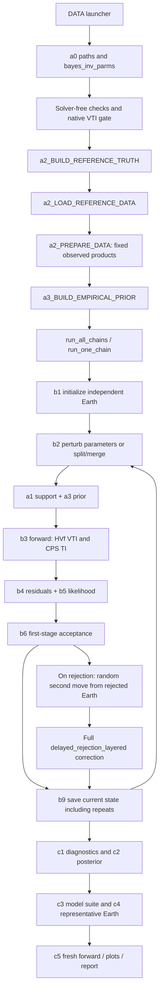

# Current layered THBI workflow and debugging map

Updated November 10, 2026. Active profile: `reference100_vti`. All MATLAB
stage bodies and helpers are in this repository. CPS executables remain
external native dependencies; the modified HVf source is packaged under
`native/HVf_VTI/`. No runtime code is imported from Downloads THBI/HBI.

**Validation status:** the complete HVSR modal search now passes refinement
and independent CPS surface-wave amplitude checks on the truth and preserved
LVZ/Love-cutoff fixtures. A guarded CPS fundamental-mode selector and isolated
period retry address spurious or missing batch roots. The final native
chain/restart/postprocessing audit is still in progress; this is not yet a
production-readiness claim. See [native audit](THBI_NATIVE_AUDIT_2026-11-10.md).
Earlier 10-mode synthetics must be regenerated with the corrected operator.

## Launch scripts

First build the new executable from the repository root:

```sh
sh native/HVf_VTI/build.sh
```

| MATLAB script | What it does |
|---|---|
| `DATA/generate_ecm1_ak135_five_observables.m` | Solver-free checks, native VTI comparison gate, known Earth, all synthetic curves/RF products and plots; **no inversion** |
| `DATA/run_ecm1_thin_thbi_100s_ps_sp.m` | Same validation, synthetic inputs, native split/merge/sensitivity checks, prior draws, two chains, posterior/final-forward checks and plots |
| `DATA/validate_thbi_before_synthetic.m` | Algorithm/native audit, two 6-step execution checks, checkpoint and c1–c5 verification, plots and HVSR convergence gate; never a recovery experiment |

The inversion launcher currently retains **2 chains × 15,000 iterations,
8,000 burn-in per chain**, serial execution. Its `run_inversion=false` setting
stops after synthetic generation and native preflight. Change the explicit
settings at its top when a different run length is intended. The older
`run_ecm1_thin_thbi_2chains_10k.m` selects an earlier profile and is not the
updated VTI/HK/CCP test.

## Data through final inversion



| Stage/file | Calculation and debugging responsibility |
|---|---|
| `THBI/a0_STARTUP_BAYES.m` | Adds this checkout's paths, discovers native binaries and detects shadowed external functions |
| `THBI/parms/bayes_inv_parms.m` | `reference100_vti` inherits `reference100` and the 100-s sampling; sets priors, linked anisotropy, moves, RF products and synthetic settings |
| `THBI/a2_LOAD_DATA.m` | Dispatches the reference synthetic loader; `truth_only=true` executes no native forward |
| `THBI/a2_BUILD_REFERENCE_TRUTH.m` | Reads selected published ECM1 rows and AK135 nodes, constructs the known zoned Earth and labels assigned anisotropy/material closure |
| `THBI/a2_LOAD_REFERENCE_DATA.m` | Generates native curves/Ps/Sp once; builds observed Ps waves and Sp depth stack, adds declared noise and saves fixed observations |
| `THBI/a2_PREPARE_DATA.m` | Validates data grids/errors; curve covariances and RF products are distinct data structures |
| `THBI/a1_TEST_CONDITIONS.m` | Ordered interfaces/counts, material bounds, monotone sediments and crust/mantle LVZs, separate Moho conditions, kappa/xi/noise support and elastic stability |
| `THBI/a3_CALC_LOG_PRIOR.m` | Normalized count/interface/velocity/kappa/xi/noise densities in sampled coordinates; constraints multiply the joint prior by an indicator |
| `THBI/a3_BUILD_EMPIRICAL_PRIOR.m` | Draws the conditioned prior for comparison, not a truth-centered posterior initialization |
| `THBI/b1_INITIATE_MODEL.m` | Independent dispersed prior draws for each chain |
| `functions/make_mod_from_parms.m` | Converts zone fractions and Vs to physical thicknesses, Vp/rho and a shared seven-column VTI matrix |
| `THBI/b2_PERTURB_MODEL.m` | Eleven move families with actual transformations, selection probabilities, proposal densities and split/merge Jacobians |
| `THBI/b3_FORWARD_MODEL.m` | Native calculation blocks: model refinement, HVf modal/body-wave HVSR and ellipticity, CPS TI phase/group, Ps response/HK and Sp components/CCP |
| `THBI/b3_FORWARD_MODEL_HK.m` | Candidate harmonic crustal Vs and mean anisotropy; stacks **fixed observed Ps waves**, interpolates candidate H/kappa energy and normalizes by the grid maximum |
| `THBI/b3_FORWARD_MODEL_RF_CCP.m` | CPS Z-up to required Z-down, isotropic-surface P/SV rotation, signed parent normalization, matched Gaussian parent, filtering, VTI migration and daughter depth taper |
| `THBI/b4_CALC_MISFIT.m` | First four whitened curve energies; Ps stack-energy error; Sp weighted normalized full cross-convolution |
| `THBI/b5_CALC_LIKELIHOOD.m` | Curve covariance likelihoods with sampled multipliers; RF effective-DOF likelihoods with sampled absolute sigma and their normalization |
| `THBI/b6_IFACCEPT.m` | One first-stage log-acceptance rule used for both actual and hypothetical reverse tests |
| `functions/delayed_rejection_layered.m` | Full second-stage random-path acceptance, including reverse proposals, both rejection factors and RJ Jacobians |
| `THBI/b9_SAVE_RESULT.m` | Every current state, including rejected repeats; variable-size layers, kappa, xi, noise, move history and scheduled predictions |
| `THBI/run_one_chain.m` | Per-chain RNG/scratch, forward caching for noise-only moves, checkpoints, source/native identity guards and failure preservation |
| `THBI/c1_PROCESS_RESULTS.m` | Common-depth Vs/count summaries, move statistics, classical and rank/folded Rhat, bulk/tail ESS, kappa and free xi diagnostics |
| `THBI/c2_BUILD_POSTERIOR.m` | All retained states with their repeated-state weights |
| `THBI/c3_BUILD_MODEL_SUITE.m` | Samples variable-layer models onto common physical depths; never aligns arbitrary layer indices |
| `THBI/c4_FINAL_MODEL.m` | Selects an actual retained Earth by a fixed-reference-noise fit score; it is not a cross-dimension MAP claim |
| `THBI/c5_FINAL_FORWARD_MODEL.m` | Recomputes that Earth from scratch and compares likelihood/residuals with its stored state |
| `THBI/c2_PLOT_RESULTS.m` and `functions/plotting/plot_ANISOTROPY.m` | Model/curve/RF/count/convergence plots, xi traces and the distinction between average Vs, Vsv and Vsh |

## True Earth and anisotropy

ECM1 **cell 19178, 36.5°N, 82.5°W** has 10 m sediment and a 43.7731-km Moho.
Original selected crust/sediment rows, source URLs and hashes are in
`DATA/reference_models/`. ECM1 thickness and Vs are retained. Vp and density
are projected onto the declared THBI material relations for matched synthetics;
original published Vp/rho remain separate in the saved truth.

The five mantle intervals end at 77.5, 120, 165, 210 and 250 km. Their Vs
values are midpoint interpolations of **AK135 reference mantle**, with a
4.5912-km/s half-space at 250 km. This is not a measured local mantle profile.
AK135 does not impose an LVZ here; the inversion nevertheless permits LVZs.
`par.conditions.monotonic = [true false false]`: following the user's
November10 decision with Josh, sediment Vs must be nondecreasing. Crust and
mantle Vs may decrease with depth. Initialization sorts only sediment
velocities, and the prior includes its ordered-uniform factorial density.
Positive basement/Moho jumps and bounded near-Moho secants remain separate
conditions in `a1_TEST_CONDITIONS`. Interface depths are ordered in every zone.


The THBI example samples one crustal `xi=(Vsh/Vsv)^2` in [0.8,1.2], with
`phi=(Vpv/Vph)^2=2−xi`, elastic eta=1, and isotropic sediments/mantle.
This test assigns crustal xi=1.06. That assignment is explicitly separate
from published ECM1/AK135 values. All forward solvers receive the same tensor.
Details and equations: [HVf VTI source notes](../native/HVf_VTI/README_VTI.md).

## Five observables, six likelihood blocks

The observable families remain HVSR, ellipticity, phase velocity, group
velocity and receiver functions; Ps and Sp are separate likelihood blocks.
Surface-wave periods and RF filter bands extend to 100 s. An RF filter period
is distinct from a conversion-time window. Coverage alone does not prove
250-km resolution; the native preflight reports deep-perturbation responses.

Ps uses H–kappa stack energy with phase weights [0.5,0.3,0.2], candidate
harmonic-average Vs and arithmetic-average xi/phi/eta. Its observation is not
a direct waveform residual. The true Earth can have nonzero HK error because
averaging a layered crust is an approximation. Mantle-only changes must leave
this crustal stack product unchanged.

Sp uses the full P-daughter/SV-parent cross-convolution, depth taper and
reference depth weighting. The source-parent Gaussian is matched to CPS's
component filter. Migration integrates VTI vertical slownesses over physical
layers, retaining negative Sp lag. The surface rotation is valid because the
sediment zone is constrained isotropic. Synthetic stack-domain correlated
noise is declared explicitly; this is not a real-station event/CCP loader.

The fixed Hopper-dataset override of 43 effective degrees of freedom is not
copied into new synthetics. Sp DOF is estimated once from the observed daughter
using the reference Silver–Chan spectral expression. It never changes with
a candidate model. First-four gamma priors and RF absolute log-uniform sigma
priors are separate; their likelihood normalizations are retained.

## Birth/death, delayed rejection and storage

Birth splits one physical layer and preserves its thickness-weighted mean
Vs; death applies the exact inverse. Both use the full forward/reverse
selection and contrast densities. No spline-knot factors enter this layered
map. K is read from actual zone velocity-vector lengths. Zone anisotropy is
unchanged by layer split/merge, so it adds no dimension-changing auxiliary.

Both stages use the ordinary random mixture. Stage two starts from the
rejected valid first model, as selected by the user. Invalid first proposals
are rejected without a retry. See [random second-move derivation](THBI_RANDOM_SECOND_MOVE.md).
The second stage may contain birth/death or anisotropy moves. The old HBI
scalar delayed-rejection helper remains available for legacy profiles but is
not the active transdimensional acceptance rule.

Do not resume old waveform/isotropic checkpoints into this profile. Schema
v8 stores xi and source/native identities; changing code, data, settings or
executables requires a new run. Outputs remain ignored under
`DATA/transdimensional/`; each launcher makes a timestamped directory.
Look first at `inputs.mat`, `vti_preflight/`, `native_preflight/`, each
`chain_XX/checkpoint.mat`, then `results.mat`, `postprocessing.mat`,
`test_report.mat` and `figures/`. Native failure folders preserve inputs/logs.

## Remaining scientific checks

- Native isotropic-limit and nonzero-anisotropy fundamental comparisons passed
  on the truth and xi-bound/LVZ fixtures. These do not validate all HVSR modes.
- Complete modal sums and root/body-quadrature refinement passed on the truth
  and preserved LVZ fixture. CPS independently checks surface-wave roots and
  Green amplitudes; VTI body waves do not yet have a second independent solver.
- Native two-chain execution/restart/c1–c5 audit is being repeated with the
  corrected CPS wrapper and sediment monotonicity restored. Production remains user-run.
- Shallow discontinuity recovery, mixing, uncertainty calibration and depth
  resolution remain empirical checks after successful native preflight.
- **? OPEN — dispersion-only extension/shared-Earth consistency comparison:**
  deferred by the user. This work does not resolve or close it.

[Historical November 8 workflow](THBI_WORKFLOW_2026-11-08.md) records the older
extended100 setup; it is not the current launcher configuration.
