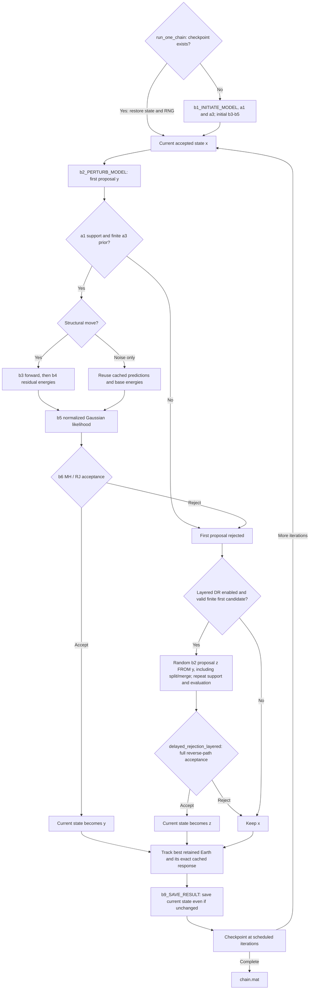

# Historical extended100 workflow (superseded)

See [current reference100_vti workflow](THBI_WORKFLOW.md).

Reviewed 2026-11-08. This describes the **active extended100 synthetic workflow**
in `CONUS-VS-UP`, not the original Downloads THBI or the separate fixed-layer
`HBI/` implementation. The MATLAB files contain functions with explicit main
calculation blocks; the `DATA/` files are the scripts the user launches.

**The active data stage generates synthetics. It does not yet load observed
station files.** Solver-free numerical checks have now run in Octave;
MATLAB could not obtain its license (-96). Native CPS/HVf execution and the
new full inversion remain user-run. See [current random-second-move configuration](THBI_RANDOM_SECOND_MOVE.md)
and [the 250-km RF/data comparison](THBI_EXTENDED100_REVIEW.md). The earlier
[workflow audit](THBI_WORKFLOW_AUDIT.md) is a historical static snapshot.

## 1. Start at the correct launcher

| Script | What happens when YOU run it |
|---|---|
| [check_thbi_layered_dr.m](../DATA/check_thbi_layered_dr.m) | Algebra, toy-chain, resume, failure and results checks for the new layered two-stage RJ kernel; no native solvers. |
| [check_thbi_extended100.m](../DATA/check_thbi_extended100.m) | Algebraic/toy tests, native Ps/Sp controls, thin truth, all six forward data blocks, RF-band figures and split/merge forward checks. Stops before production inversion. |
| [run_ecm1_thin_thbi_100s_ps_sp.m](../DATA/run_ecm1_thin_thbi_100s_ps_sp.m) | The full current run: preflight, two independent chains of 15,000 iterations, 8,000 burn-in, all retained-state checks, posterior processing, fresh final forward calculation and plots. |
| [run_ecm1_thin_thbi_2chains_10k.m](../DATA/run_ecm1_thin_thbi_2chains_10k.m) | Earlier five-block/Ps-only configuration. Does not select the new extended100 profile. |
| [run_ecm1_thin_thbi.m](../DATA/run_ecm1_thin_thbi.m) | Shorter legacy pilot by default; final forward calculation optional. |
| [check_thbi_implementation.m](../DATA/check_thbi_implementation.m) | Legacy cheap implementation checks; optional native/prior-only tests. |

The extended100 profile inherits extended60, then overrides depth, grids and RF sampling.
The extended100 settings are created by `bayes_inv_parms('extended100')`.
The launcher then overrides some run/output settings. **The final `par`
saved in `inputs.mat` is the authoritative configuration for that run.**
Editing a default above the extended100 block may have no effect if that
block, or the DATA launcher, replaces it later.

## 2. End-to-end control flow

```mermaid
flowchart TD
    L["DATA run_ecm1_thin_thbi_100s_ps_sp"] --> A["a0_STARTUP_BAYES: paths and implementation checks"]
    A --> P["bayes_inv_parms + launcher overrides + validate_configuration"]
    P --> T["Implementation tests and native RF controls"]
    T --> D["a2_LOAD_DATA: true thin Earth"]
    D --> F0["b3_FORWARD_MODEL on the true Earth"]
    F0 --> N["Select grids; fix errors and covariance; add seeded noise"]
    N --> I["Save inputs.mat and truth_forward"]
    I --> PF["Native split / inverse merge checks"]
    PF --> PR["a3_BUILD_EMPIRICAL_PRIOR, if nprior > 0"]
    PR --> RC["run_all_chains"]
    RC --> C["run_one_chain: b1-b9 loop for each chain"]
    C --> H["Validate full histories and accepted count transitions"]
    H --> S["c1_PROCESS_RESULTS: retained summaries and diagnostics"]
    S --> CP["c2_BUILD_POSTERIOR: collect retained parameters"]
    CP --> MS["c3_BUILD_MODEL_SUITE: Vs, Vp, density at common depths"]
    MS --> FM["c4_FINAL_MODEL: summaries and one retained Earth"]
    FM --> FF["c5_FINAL_FORWARD_MODEL: recompute and check saved likelihood"]
    FF --> PL["c2_PLOT_RESULTS + plot_RF_BANDS + reports"]
    PL --> O["Results, figures and LATEST_RUN.txt"]
```



There are two different `c2` files: one builds the posterior collection,
the other makes figures. Their names do not mean the plotting stage runs
before `c3`–`c5`. No separate `b7`/`b8` is called: chain orchestration,
delayed rejection and checkpoint control live in `run_one_chain`.

## 3. Setup, data and priors — each file's role

| File | Inputs → outputs / responsibility | Change here when… |
|---|---|---|
| [a0_STARTUP_BAYES.m](../THBI/a0_STARTUP_BAYES.m) | Locates project, parameter, helper, test and native executable directories. Adds explicit MATLAB paths and checks `which` for stages/helpers. Returns `repo, paths`. | MATLAB is calling the wrong HBI/THBI copy, or solver/output paths are wrong. |
| [bayes_inv_parms.m](../THBI/parms/bayes_inv_parms.m) | Profile → `par`. Defines priors, zones, K bounds, starting model, move scales/probabilities, RF/solver settings, data grids, noise and output settings. | Changing period coverage, allowable structures, proposal sizes, noise assumptions or default run settings. Check launcher overrides too. |
| [validate_configuration.m](../functions/validate_configuration.m) | Checks `par` before costly work: compatible shapes, normalized move probabilities, count/prior bounds, RF record/band sampling, seeds and storage options. | Introducing a new setting or changing the configuration schema. This validates configuration, not one proposed Earth. |
| [a2_LOAD_DATA.m](../THBI/a2_LOAD_DATA.m) | `par` → `data, TRUEmodel, forward`. Defines h/Vs, derives Vp/density, checks true structure against support, calls b3, selects observations, fixes uncertainties/covariance, adds seeded noise and preserves native files. | Changing the known synthetic truth, noise-generation logic, observation selection, or eventually implementing an observed-data reader. |
| [a2_PREPARE_DATA.m](../THBI/a2_PREPARE_DATA.m) | Supplied `data` → validated data with `N, L0, logdetC0`. Accepts negative RF times; other x coordinates must be positive. | Changing data validation or whitening for supplied observations. **The synthetic a2_LOAD_DATA contains the equivalent block inline; it does not call this helper. Keep both consistent.** |
| [a1_TEST_CONDITIONS.m](../THBI/a1_TEST_CONDITIONS.m) | One candidate Earth → pass/fail + reason. Enforces counts, ordered interface spacing, Vs bounds, zone boundaries, optional sediment monotonicity, basement/Moho contrasts and noise support. | Valid models are being excluded, invalid ones accepted, or changing physical constraints. Called for starts, proposals, priors and reconstructed results. |
| [a3_CALC_LOG_PRIOR.m](../THBI/a3_CALC_LOG_PRIOR.m) | Earth + `par` → `logP` and component terms. Includes count mass, ordered-interface normalization, velocity-volume factors, zone boundaries, half-space and truncated-normal log-noise priors. | Changing the statistical prior. Dimension-dependent factors matter for birth/death; do not replace this with a feasibility check. |
| [a3_BUILD_EMPIRICAL_PRIOR.m](../THBI/a3_BUILD_EMPIRICAL_PRIOR.m) | Prior settings + number of draws → prior envelopes/count distributions using b1 in prior-draw mode. No likelihood or native solves. | Inspecting the actual prior after physical conditions. This is a comparison sample, **not** an empirical prior learned from the synthetic observations. `nprior=0` skips it. |

### What is actually in `data`

Every block has `x, clean, obs, sig, R, N, L0, logdetC0` in the synthetic
workflow. `clean` is the true prediction; **b4 compares `obs` with trial
predictions, never `clean`**. `L0*L0' = diag(sig)*R*diag(sig)` defines fixed
base covariance C0. Gamma changes the covariance scale during inversion,
not the grids or residual mask.

| Data key | x coordinate | Prediction and active solver | Current coverage |
|---|---|---|---|
| `hvsr` | Frequency, Hz | HVf diffuse-field H/V, configured Rayleigh/Love modes plus body contribution | 0.01–25 Hz |
| `ellip` | Period, s | HVf fundamental Rayleigh H/V; no Love/body contribution | 3–100 s |
| `cph` | Period, s | CPS `surf96`, fundamental Rayleigh phase velocity, km/s | 9–100 s |
| `ugr` | Period, s | CPS `surf96`, fundamental Rayleigh group velocity, km/s | 3–100 s |
| `rf` | Lag relative to P, s | CPS `hrftn96 -P`, signed R/Z, then explicit period filtering | 1.25–100-s band; -100 to +120-s data window |
| `rf_sp` | Lag relative to S, s | CPS SV R/Z components, regularized Z/R deconvolution, then period filtering | 3–100-s band; -120 to +100-s data window |

These are **six likelihood blocks within five observable families**. The
short/intermediate/30–60-s/60–100-s RF figures are diagnostic filtered views; they
are not extra independent likelihood blocks. RF bands and lag windows are
different settings. Ps/Sp each currently have one ray parameter and filter
configuration, not a distribution of events/ray parameters.

### True Earth versus inferred parameters

The prescribed thin truth is in the first block of `a2_LOAD_DATA`.
The 10-m, 50-m, 130-m and 1-km interfaces remain in that model. The
sediment-zone base is **130 m**; the legacy `sed_thickness=.05` metadata
labels the soft cap and does not define the inversion's zone boundary.
The Moho is 40 km. Extended100 continues the original deep 4.54-km/s material
to a 250-km model base and below, without a new true deep discontinuity.

The sampled model has three zones. Zone z has K_z velocities and K_z-1
internal interface fractions. Also sampled: sediment base, Moho depth,
half-space Vs and six eta=log(gamma) values. K is **variable**, bounded by
[1,1,1] and [8,10,8]. Truth uses K=[3,4,3], but the reference start uses
[3,3,2], jittered independently for each chain. Neither the true Earth nor
its true K is passed into `run_all_chains`; only `par` and `data` are passed.

## 4. One chain, one iteration



Numerical/programming failures are a separate path: the extended100 profile
saves the failed model/native files and **stops at the first native failure**.
A failed solver is not sent to a second-stage DR retry. In layered mode an
out-of-support first candidate is not retried either. Configuration and
programming errors propagate instead of being treated as ordinary rejections.

| File | Responsibility and variables worth inspecting |
|---|---|
| [run_all_chains.m](../THBI/run_all_chains.m) | Calls independent chains serially by default. Optional process workers; thread workers disallowed because native calls change cwd. |
| [run_one_chain.m](../THBI/run_one_chain.m) | Entire iteration controller: RNG, current/trial/second states, native calls versus cached noise moves, DR, retained-best tracking and checkpoints. Inspect `state`, `trial`, `second`, `ptb`, `accepted`, `iter`. |
| [b1_INITIATE_MODEL.m](../THBI/b1_INITIATE_MODEL.m) | Makes a feasible start from the reference settings plus jitter, or draws from the specified prior. Uses a1 and model assembly. Inspect failed-start `why` and the resulting K/f/Vs. |
| [b2_PERTURB_MODEL.m](../THBI/b2_PERTURB_MODEL.m) | Chooses velocity, interface, boundary, birth, death or noise. Birth splits a physical layer; death merges adjacent daughters. Computes forward/reverse proposal densities and Jacobian. Inspect `ptb.valid/reason`, K before/after and log-q terms. |
| [make_mod_from_parms.m](../functions/make_mod_from_parms.m) | Zone fractions and Vs → physical thicknesses, `[h,Vp,Vs,rho]`, K and metadata. Derives Vp/density deterministically from Vs. Count/forward code must use physical layers, not numerical subdivisions. |
| [b3_FORWARD_MODEL.m](../THBI/b3_FORWARD_MODEL.m) | All active native calls are in this main body. One refined physical Earth drives all six blocks; output maps back to fixed observation coordinates. Returns `predata`, optionally full `fwd` metadata. |
| [b4_CALC_MISFIT.m](../THBI/b4_CALC_MISFIT.m) | r=obs-predicted; w=L0\r; E2=w'w, plus raw RMS. No noise-scale update here. |
| [b5_CALC_LIKELIHOOD.m](../THBI/b5_CALC_LIKELIHOOD.m) | Uses C=exp(2eta)*C0 and retains both residual and covariance-normalization terms; sums independent data blocks. Inspect E2, eta, per-block logL and joint logL. |
| [b6_IFACCEPT.m](../THBI/b6_IFACCEPT.m) | First-stage log ratio = change in logL + change in logP + log-q reverse/forward + log Jacobian. Not a lowest-misfit-only acceptance rule. |
| [delayed_rejection_layered.m](../functions/delayed_rejection_layered.m) | Current extended100 second-stage rule: full proposal from rejected y, including splits/merges, both proposal ratios/Jacobians, both rejection factors (Q2 is the ordinary random proposal; its targeting correction is zero); both first-stage probabilities reuse b6. |
| [delayed_rejection_damp.m](../functions/delayed_rejection_damp.m) | Optional `fixed_scalar` comparison mode: smaller same-coordinate proposal from x, without dimension changes. |
| [birth_contrast_logpdf.m](../functions/birth_contrast_logpdf.m) | Exact narrow/broad Gaussian mixture density shared by a birth and its reverse death. Changing a contrast draw requires changing/checking this density too. |
| [b9_SAVE_RESULT.m](../THBI/b9_SAVE_RESULT.m) | Stores K, fractions, Vs, boundaries, eta, likelihood, E2, acceptance and move diagnostics. Saves current predictions at configured retained iterations. **Repeated rejected states are kept.** |
| [save_checkpoint.m](../functions/save_checkpoint.m) | Saves a temporary checkpoint then renames it, preserving accepted state, complete history, RNG and run specification. |
| [source_snapshot.m](../functions/source_snapshot.m) | Captures exact THBI/shared-helper source for resume comparison. Native binaries are external; do not change them during a run/resume. |
| [preserve_forward_failure.m](../functions/preserve_forward_failure.m) | Writes failure model, settings/data, context, RNG, exception and native scratch files for diagnosis. |

The full Gaussian block is:

```text
E2_d   = ||L0_d \ (obs_d - prediction_d)||^2
logL_d = -0.5 * [N_d*log(2*pi) + logdet(C0_d)
                 + 2*N_d*eta_d + E2_d*exp(-2*eta_d)]
```

For every zone, `count_N_layers_in_mod` counts K from its Vs vector;
`make_mod_from_parms` also assembles `model.K`. Birth/death actually change
those vectors in b2. A second-stage accepted path can contain two splits or
merges; `dr_move/dr_zone` record the second leg separately. There is no separate function that estimates one
single optimal layer count before MCMC.

### Forward utilities beneath b3

| Helper | Purpose / modification point |
|---|---|
| `validate_layer_model`, `refine_layer_model` | Check units/physical matrix, merge identical neighboring materials, subdivide thick layers without smoothing contrasts; enforce the CPS layer limit. These subdivisions are not inferred K. |
| `find_bin`, `quote_shell_path`, `merge_defaults` | Resolve native executables and command/configuration details. Use absolute executable directories. |
| `write_elastic_cps_model` | CPS flat, isotropic, elastic model serialization. HVf input is written in b3 after conversion to SI units. |
| `read_cps_sac` | SAC byte order, sample/header validation and time/grid metadata. |
| `waterlevel_receiver_function` | Sp signed Z/R spectral deconvolution, water level, taper and Gaussian. |
| `receiver_function_bands` | Full RF period band plus diagnostic band views, applied identically to true and trial waveforms. |
| `forward_receiver_function_cps` | Standalone Ps utility used in native controls. The inversion's Ps implementation is visible inside b3. |

`forward_five_observables`, `hv_prediction`, `dispersion_prediction`,
`ecm1_thin_true_model` and `run_synthetic_thin` support the earlier standalone
forward example. **They are not the active THBI forward/data entry points.**
Editing only those helpers will not change the numbered THBI inversion.

## 5. From complete chains to final figures

| Stage/helper | What it computes | What it does NOT mean |
|---|---|---|
| [c1_PROCESS_RESULTS.m](../THBI/c1_PROCESS_RESULTS.m) | Retained Vs envelopes, K probabilities, interface counts, move/DR statistics, cached-response percentiles and classical split R-hat. For new runs selects the best retained cached fit. | Completion or narrow bands do not establish convergence. Legacy files without retained-best caches are explicitly labeled as visited-fit results. |
| [c2_BUILD_POSTERIOR.m](../THBI/c2_BUILD_POSTERIOR.m) + `collate_allmodels_perchain` | Collect all iterations after burn-in, including repeats, and their chain/iteration IDs. Compute zone means, boundary jumps, K masses and gamma distributions. | Accepted-only draws are not equally weighted posterior samples. |
| [c3_BUILD_MODEL_SUITE.m](../THBI/c3_BUILD_MODEL_SUITE.m) + `model_from_chain`, `sample_layer_model` | Reconstruct every physical model and evaluate stepwise Vs, Vp and density on a common depth grid. | Layer slot j is not averaged across differing K. |
| [c4_FINAL_MODEL.m](../THBI/c4_FINAL_MODEL.m) | Pointwise 5/50/95% profiles plus one actual retained Earth, chosen by minimum sum of base E2; first occurrence breaks ties. | A pointwise median need not be a physical sampled Earth; this is not cross-dimension MAP selection. |
| [c5_FINAL_FORWARD_MODEL.m](../THBI/c5_FINAL_FORWARD_MODEL.m) | Recompute b3→b4→b5 on that actual retained Earth. The launcher compares fresh E2/logL against its exact saved chain row. | It does not forward-model the pointwise median. |
| [c2_PLOT_RESULTS.m](../THBI/c2_PLOT_RESULTS.m) | Joint fits, shallow/full Vs, layer counts, noise/logL histories, R-hat and additional THBI-style diagnostic helpers. Checks fit/final-selection identities for new-format runs. | A best-fitting curve is not the full posterior. |
| `write_thbi_report`, `plot_RF_BANDS` | Text diagnostics and signed RF full/short/intermediate/long-period views. | The RF bands are not independent data replicates. |

`functions/plotting/` also contains: `plot_HEATMAP_ALLMODELS` (all-state
Vs/Vp distributions), `plot_SUITE_of_MODELS` (retained profiles),
`plot_TRADEOFF` (scalar correlations), `plot_PARAMETERISATION` (physical
layers), `plot_PERTURBATIONS` (proposal counts), `plot_PRIORvsPOSTERIOR`,
`plot_LAYER_TRENDS`, `plot_progress_chain` and `plot_RF` (signed wiggles).

`split_rhat` uses fixed-depth Vs and fixed-size metrics, not variable layer
slots. Identical constants give NaN (undefined), differing constant chain
segments give Inf. Rank-normalized R-hat, ESS and automatic stopping are
not implemented. Burn-in is a configured cutoff, not an estimated end of
convergence.

## 6. Files on disk and continuation

Outputs are under `DATA/transdimensional/ECM1_thin_THBI_<profile>_<timestamp>/`.

| Output | Use |
|---|---|
| `launcher.m`, `test_settings.mat` | Exact launched script and initial settings/runtime record |
| `inputs.mat`, `truth_forward/` | Final resolved par, observations, truth, forward metadata and true-model native files |
| `native_rf_checks/`, `native_split_merge/preflight.mat` | Known-model RF controls and actual-grid split/merge comparisons |
| `prior.mat` | Optional conditioned-prior draws summarized for comparison |
| `chain_XX/checkpoint.mat`, `chain_XX/chain.mat` | Restart state and completed chain histories |
| `first_forward_failure/`, `fatal_forward_failure/` under a chain | Failed models, errors and native logs |
| `results.mat` | par/data/truth/chains and c1 summary |
| `postprocessing.mat` | posterior, common-depth model suite, final retained model |
| `final_forward/final_forward.mat` | Fresh final predictions, E2 and likelihood |
| `joint_fit.*`, `shallow_model.png`, count/mixing figures, RF-band figures | Visual checks |
| `test_report.*`, `inversion_report.txt` | Execution checks, moves, DR, fits and mixing diagnostics |

`resume_thbi(result_dir)` resumes with unchanged source, data and configuration.
It rebuilds ordinary summaries/plots but does not run all launcher-specific
preflight/final-validation report blocks. Do not interpret a resume as a
rerun of those checks. Changed source requires a fresh run.

`DATA/postprocess_ecm1_thin_thbi.m` rebuilds saved summaries and model-suite
outputs without sampling; optional c5 is disabled by default.
`DATA/plot_ecm1_thin_thbi.m` replots saved results.
`DATA/plot_ecm1_thin_thbi_colored_chains.m` draws accepted models by chain
and uses all retained states for statistical summaries; it invokes no
native forward calculation.

## 7. Where to look first when something is wrong

| Symptom/change | Inspect first |
|---|---|
| Wrong truth or missing shallow discontinuity in the true model | a2_LOAD_DATA h/Vs and zone edges; distinguish 50-m soft cap from 130-m zone base |
| Good true curves, poor recovery near an interface | a1 prior support, b2 move scales/count transitions, gamma histories, retained chain overlap; longer periods alone do not resolve shallow mixing |
| Need longer/shorter periods or another RF filter | parms extended100 block, launcher overrides, then b3 and RF helpers; regenerate synthetics |
| Correct Vs but questionable Vp or density / RF mismatch | make_mod_from_parms and matching equations in a2_LOAD_DATA; these quantities are derived, not sampled |
| K never changes | b2 eligibility/count limits, a1 rejection reasons, birth/death q terms, and per-zone acceptance history |
| RF wrong sign, timing, sample count or edge effects | native RF control files; b3 Ps/Sp blocks; SAC reader; deconvolution/bands |
| One observable dominates or gamma inflates | fixed sig/R in a2, b4 whitening, b5 normalization and noise prior settings |
| Plotted final fit disagrees with c5 | c1 retained-best identity, c4 selection and stored model/iteration; new runs assert equality |
| Solver fails partway | failure.mat/failure.txt and native logs first; do not bypass the failure gate to force a long run |
| Want real observed data | Add/replace file-reading and processing in a2, call the shared preparation logic, supply RF p/filter metadata; update truth-dependent plotting/tests. This mode is not wired up yet. |

The present scientific assumptions remain: one flat, isotropic, elastic 1-D
Earth; deterministic Vp/density from Vs; fixed within-data covariance shape;
independent data blocks; one Ps and one Sp ray parameter; fundamental-mode
Rayleigh dispersion/ellipticity. The same forward model generates and fits
the synthetics. That checks implementation consistency, not independent
forward-physics accuracy or robustness to real-data modelling error.
